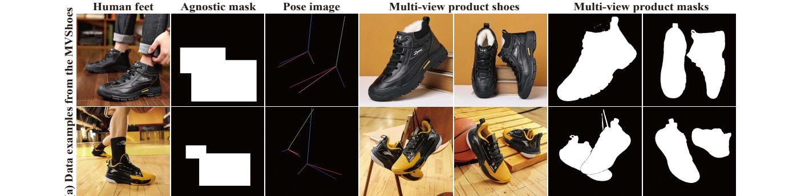

[← ShoeFit Project](https://colorful-liyu.github.io/ShoeFit/)

Multi-view footwear try-on dataset

# MVShoes-clean

A cleaned release of MVShoes for academic research in virtual footwear try-on.

[Apply for Access →](#request-access)

[Overview](#overview) · [Request Access](#request-access) · [Use Terms](#terms)

<a name="overview"></a>

## Dataset Overview

MVShoes-clean contains two product shoe views and a corresponding on-foot image for each sample. It is the release produced after additional cleaning and compliance review; selected images have undergone face replacement processing.

- **6,151** Triplets
- **5,351** Training samples
- **800** Test samples



Illustration of the data modalities from the original paper. The released files are described below.

**Version distinction.** The original paper describes 7,305 triplets with a 6,305/1,000 training/test split. MVShoes-clean contains 6,151 triplets. Report the clean release and actual split explicitly; results across the two versions are not directly interchangeable.

| Directory / File | Contents |
| --- | --- |
| `try_on_img/` | Corresponding on-foot images |
| `ref_img/`, `ref_img2/` | Two product shoe views |
| `segmentation/` | On-foot shoe segmentation masks |
| `pose/` | Foot/leg pose images |
| `inp_mask/` | Inpainting masks |
| `dataset.jsonl` | Complete manifest of 6,151 samples |
| `train.jsonl` | 5,351 training samples |
| `test.jsonl` | 800 test samples |

<a name="request-access"></a>

## Request Access

Access is limited to **non-commercial academic research**. Applications are reviewed before the dataset is provided.

1. Read the academic research use terms below.
2. Complete the application questionnaire with your name, affiliation, email, academic profile if needed, and research purpose.
3. Confirm each of the seven commitments and enter your name and the application date.
4. After approval, receive the download link and archive password at the email address supplied.

[Open Application Questionnaire →](#request-access)

Application responses are private. Download links and passwords are shared by email only. Do not post your contact information in public GitHub issues.

<a name="terms"></a>

## Academic Research Use Terms

The application requires individual acceptance of the following commitments:

1. Use the dataset only for non-commercial academic research within the approved project.
2. Do not use it for commercial products, services, deployments, or commercial model training.
3. Do not redistribute the dataset or share its download link or password with unauthorized parties.
4. Do not identify individuals or attempt to reconstruct original faces from processed images.
5. Protect the dataset from unauthorized access and use only the approved access scope.
6. Cite the ShoeFit paper and report use of the MVShoes-clean version and actual split.
7. Confirm that you have read and accept the displayed academic research use terms.

## Citation

```bibtex
@inproceedings{li2025shoefit,
  title={ShoeFit: A New Dataset and Dual-image-stream DiT Framework for Virtual Footwear Try-On},
  author={Li, Yuhan and Jin, Zhiyu and Tong, Yifan and Shang, Wenxiang and Cui, Benlei and Chen, Xuanhong and Zhu, Hangcheng and Ni, Bingbing},
  booktitle={Advances in Neural Information Processing Systems},
  year={2025}
}
```

In addition to citing ShoeFit, identify MVShoes-clean in your experimental setup.

MVShoes-clean · Non-commercial academic research only.
